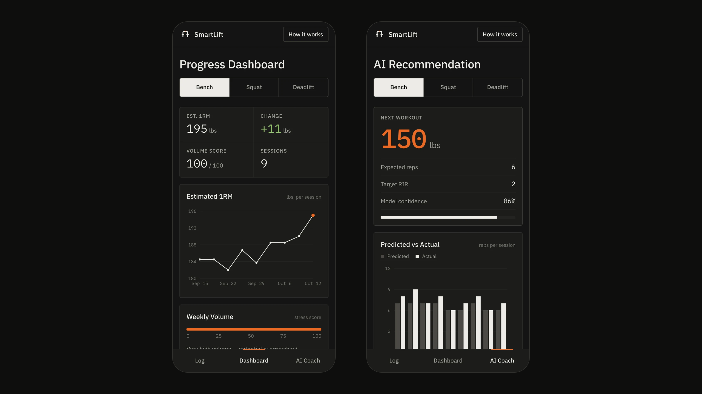
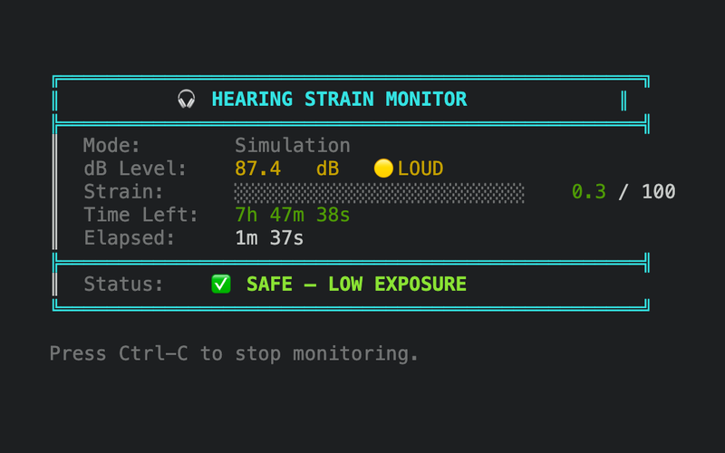
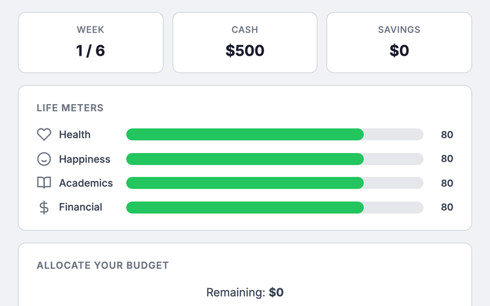
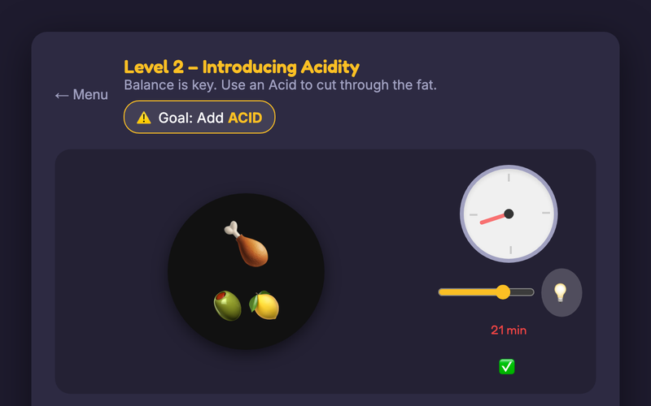

# Nithish Sabapathy

Software engineer working on backend systems, infrastructure, and applied machine learning.
SDE intern on Data Center Automation at AWS. B.S. and M.S. in Computer Science at Georgia Tech.

<table>
<tr>
<td width="50%" valign="top">

<a href="https://github.com/nithish101/resonance"><strong>Resonance</strong></a>

A real-time music visualizer for the browser. Signal processing written from scratch in Rust and compiled to WebAssembly (FFT, onsets, tempo, beat tracking, key), fed by a lock-free pipeline from an AudioWorklet to a WebGPU render worker.

60 FPS at 1080p, 500k GPU-simulated particles, 8.6 µs of analysis per audio hop, beat-tracking F-measure 0.99 on synthetic grooves.

Rust · WebAssembly · TypeScript · WebGPU · WebGL2 · AWS CDK

</td>
<td width="50%" valign="top">

<a href="https://github.com/nithish101/MLSmartLift"><strong>SmartLift</strong></a>

A workout tracker where a gradient boosting model predicts your next session's working weight, reps, and intensity, and tracks estimated 1RM over time.

Model registry in MLflow, drift and latency dashboards in Grafana.

Python · scikit-learn · FastAPI · React · PostgreSQL · Docker

</td>
</tr>
</table>

### Experience

- **Amazon Web Services**, SDE intern, Data Center Automation (Bellevue). Current.
- **Twilio**, IAM. Built performance gates into the canary pipelines for two Java auth services:
  load tests as Kubernetes Jobs through Argo Rollouts `AnalysisTemplates`, with thresholds drawn
  from 244M production requests in Datadog.
- **Ascent Consulting**, a QuickBooks-backed financial dashboard.
- **Georgia Tech Sustainable Urban Systems Lab**, urban simulation tooling.

Georgia Tech B.S. and M.S. in Computer Science (Intelligence & Theory / Machine Learning), 4.0 in
both.

### Other projects

<table>
<tr>
<td width="33%" valign="top">

<a href="https://github.com/nithish101/hearing-monitor">hearing-monitor</a>: a real-time hearing strain
monitor in C on a Raspberry Pi, reading an I2S MEMS microphone and driving an LED and buzzer
over GPIO, with a POSIX simulation mode for running headless.

</td>
<td width="33%" valign="top">

<a href="https://github.com/nithish101/Semester-Survival">Semester Survival</a>: a budgeting simulation
game. <a href="https://nithish101.github.io/Semester-Survival/">Play it</a>.

</td>
<td width="33%" valign="top">

<a href="https://github.com/nithish101/first-kitchen">First Kitchen</a>: a cooking game driven by
ingredient chemistry instead of recipes. <a href="https://nithish101.github.io/first-kitchen/">Play it</a>.

</td>
</tr>
</table>

### Tools

Java, Python, Go, C, C#, TypeScript, Rust, SQL, Bash.
Spring Boot, FastAPI, React, PyTorch, TensorFlow, scikit-learn, pandas, NumPy.
Kubernetes, Docker, Helm, Terraform, Argo Rollouts, ArgoCD, Istio, Buildkite, Datadog, AWS.

[nsabapathy6@gatech.edu](mailto:nsabapathy6@gatech.edu) ·
[LinkedIn](https://www.linkedin.com/in/nithishsabapathy/)
